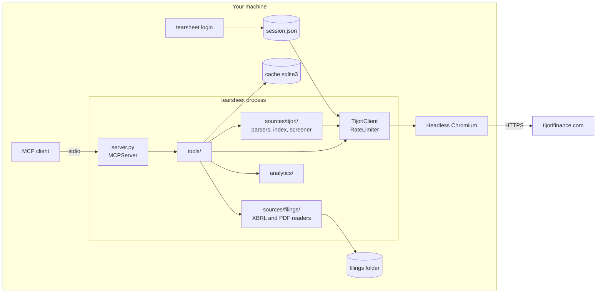
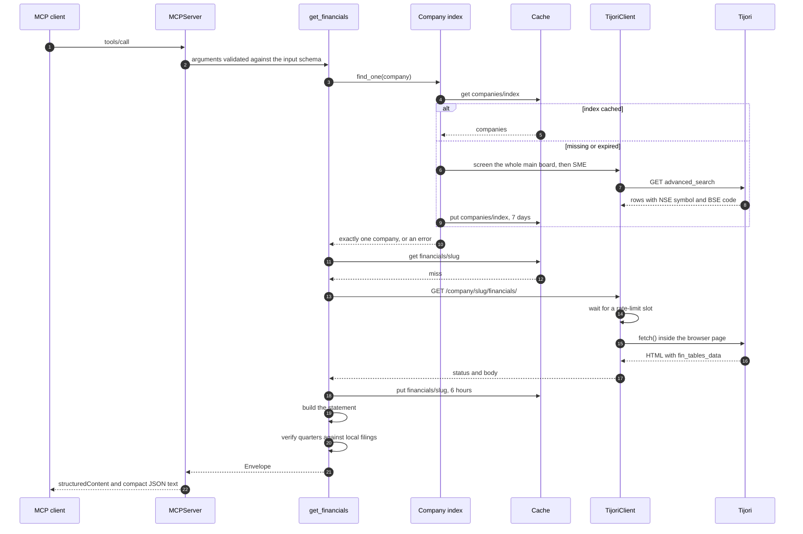
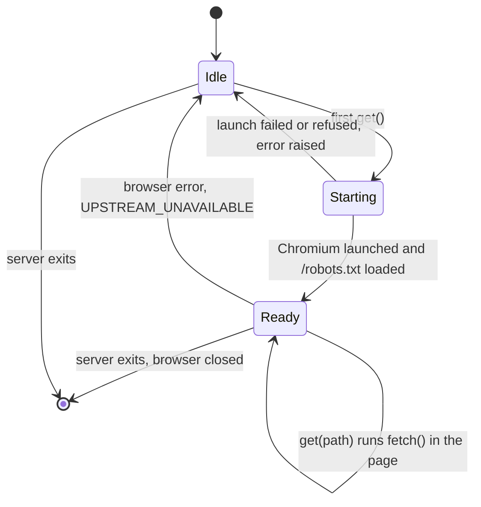
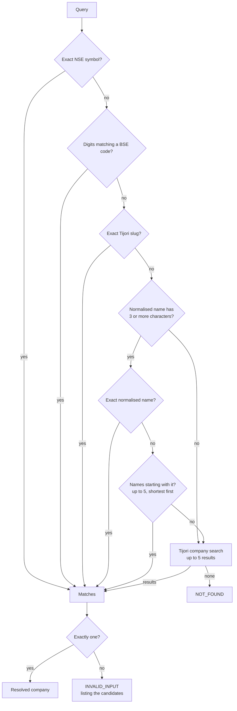
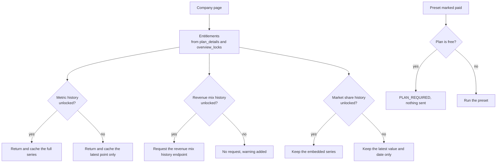
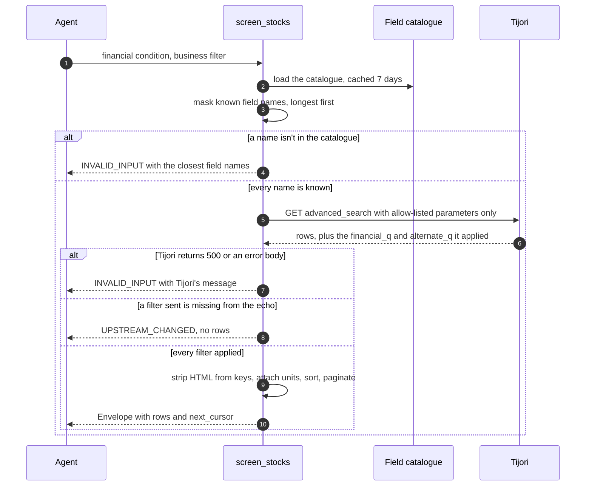
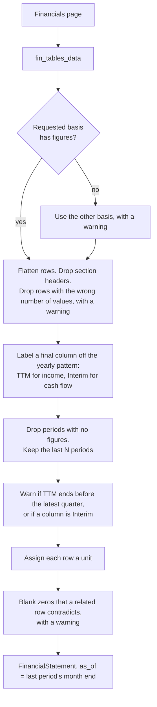
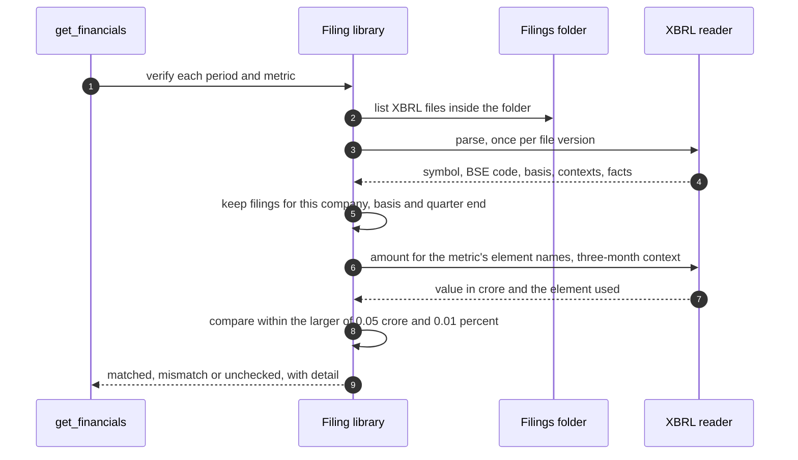
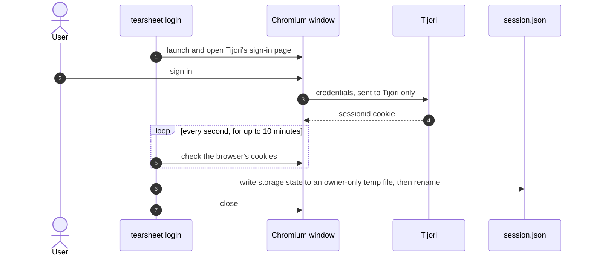

# Architecture

tearsheet is a single Python process that an MCP client starts over stdio. It reads Tijori Finance through one headless Chromium, keeps a local SQLite cache, and reads filings from a folder on disk. It has no network listener and no shared state.

## Contents

- [Components](#components)
- [Module map](#module-map)
- [Tool call lifecycle](#tool-call-lifecycle)
- [Browser client](#browser-client)
- [Company resolution](#company-resolution)
- [Plan gating](#plan-gating)
- [Screens](#screens)
- [Financial statements](#financial-statements)
- [Filing verification](#filing-verification)
- [Sign-in](#sign-in)
- [Results](#results)
- [Errors](#errors)
- [Cache](#cache)
- [Upstream behaviour](#upstream-behaviour)
- [Protocol](#protocol)
- [Testing](#testing)

## Components

The only outbound traffic goes to `tijorifinance.com`. Filings are read from disk, and nothing contacts NSE or BSE.

## Module map

| Path | Responsibility |
|---|---|
| `server.py` | Builds the `MCPServer`, registers tools in a fixed order, implements `server_status`, closes the browser on exit |
| `cli.py` | `tearsheet` (serve, the default) and `tearsheet login` |
| `login.py` | Sign-in window and session capture |
| `prompts.py` | `earnings_review`, `peer_comparison`, `thesis_check` |
| `core/envelope.py` | Result envelope, compact text, 80,000-character cap |
| `core/errors.py` | `ErrorCode` and `ToolFailure` |
| `core/cache.py` | SQLite cache with an expiry per entry |
| `core/ratelimit.py` | Minimum spacing between request starts, and a concurrency cap |
| `core/session.py` | Writes and inspects the session file without exposing cookie values |
| `core/paths.py` | `TEARSHEET_HOME` and `TEARSHEET_FILINGS_DIR` |
| `core/units.py` | Converts rupees, lakh and million to crore |
| `analytics/ratios.py` | Growth, CAGR, and minimum, median and maximum |
| `sources/tijori/client.py` | Browser client |
| `sources/tijori/companies.py` | Company index and resolver |
| `sources/tijori/screener.py` | Guarded screens and presets |
| `sources/tijori/catalogue.py` | Screener field catalogue and query check |
| `sources/tijori/financials.py` | Statement builder and fund flow |
| `sources/tijori/company_page.py` | Snapshot, plan entitlements, metric list, revenue mix, market share |
| `sources/tijori/ownership.py` | Shareholding table |
| `sources/tijori/markets.py` | Market monitor tables and constituents |
| `sources/tijori/pages.py` | Shared HTML and embedded JSON parsing |
| `sources/filings/files.py` | Folder listing, path guard, size limits |
| `sources/filings/xbrl.py` | XBRL contexts and facts |
| `sources/filings/pdf.py` | PDF page text and search |
| `sources/filings/library.py` | Matches filings to a company and quarter |
| `tools/` | One module per tool family |

## Tool call lifecycle

`get_financials` for a quarterly statement, with an empty cache:

Tools that never contact Tijori, such as `server_status` and the filing tools, don't start the browser.

## Browser client

Tijori answers plain HTTP clients with 403 and serves a normal browser. `TijoriClient` keeps one headless Chromium with an ordinary user agent and runs `fetch()` from a page on `/robots.txt`. Company pages poll for live prices, so leaving one open would keep sending requests.

- Callers that arrive during start-up share one start task. It is shielded, so a cancelled call can't leave a half-started browser that stops the server exiting.
- Every request takes a slot from `RateLimiter`: request starts are at least 1 second apart, with at most 2 in flight.
- Paths must start with `/`, so a request can't leave the site.
- The saved session is loaded only when its cookie exists and hasn't expired.

## Company resolution

Tijori's search matches names only, and company pages show no identifiers. Screener rows include the NSE symbol and BSE code, so two whole-market screens (main board and SME) build an index of about 6,700 companies, cached for 7 days.

Normalising lowercases the text, removes anything that isn't a letter or digit, and drops a trailing "limited" or "ltd".

## Plan gating

Company pages embed `plan_details` and `overview_locks`, which describe the signed-in user's plan. A feature counts as unlocked only when its lock reads `historic: true`. A missing or malformed block counts as locked. Without a saved session, the plan is `free` and no request is made to find out.

Tijori's metric endpoint returns the full series to any account, and every company page embeds the market share series. On a free plan the extra points are discarded before anything is cached or returned.

## Screens

Tijori ignores screener parameters it doesn't recognise and still returns 200, so a misnamed filter yields an unfiltered list. Three guards prevent that.

1. **Allow-list.** `run_screen` takes named arguments only and builds the query string itself.
2. **Catalogue check.** Field names are matched longest first, because some contain "and", such as "Depreciation and Amortization". Whatever remains between operators must be a number.
3. **Echo check.** The query Tijori reports applying must contain each filter sent, ignoring spacing and case.

Presets run through Tijori's preset endpoint, the only one that applies a preset's business filter. Raw rows are cached for 30 minutes, keyed by a hash of the arguments.

## Financial statements

Statements come from the `fin_tables_data` JSON block on the financials page. `build_statement` applies these steps in order:

Units come from the row name. Names containing `%` or "margin" are percent, "(Crs)" is crore, EPS is rupees per share, and names with "days" or "cycle" are days. Only names on an explicit list are multiples. An unrecognised row in a ratio section is `as_reported`. Elsewhere the default is crore.

Fund flow comes from its own endpoint and covers trailing windows of 1, 3, 5, 7 and 10 years.

## Filing verification

For a quarterly statement, `get_financials` compares revenue, profit before tax and net profit for each period with any matching XBRL filing.

| Rule | Reason |
|---|---|
| Elements are matched by local name, from an ordered list per metric | Templates differ. Banks file `ProfitLossForThePeriod`, insurers `NetPremiumIncome` |
| Only three-month contexts count for a quarter | A second-quarter filing also holds half-year figures |
| Values are converted from rupees to crore and shown with their period | Filings use rupees; Tijori uses crore |
| Consolidated net profit prefers profit attributable to owners. If that is filed as 0, total profit is used with a note | Companies without minority holders often file 0 there |
| Comparisons use the statutory figure | Picking whichever element matches Tijori would hide real differences |
| Tolerance is the larger of 0.05 crore and 0.01% | Tijori rounds to two decimals in crore |
| XML is parsed with `defusedxml` | Filings are untrusted input |
| Paths resolve inside the filings folder, including through symlinks. Files over 50 MB are refused | Agents supply the paths |

PDF search returns pages containing every word of the query, with exact phrases ranked first.

## Sign-in

The loop watches the whole browser context, so redirects and popups during sign-in work. Closing every window cancels, and so does the time limit. Neither saves anything.

## Results

`core/envelope.py` defines the envelope every tool returns.

| Field | Type | Notes |
|---|---|---|
| `data` | object | Tool-specific, typed by the tool's output schema |
| `entity` | object | `name`, `nse`, `bse` |
| `as_of` | date | Date the data describes, such as the last period end or price date |
| `retrieved_at` | datetime | When the data was fetched from Tijori, which may be earlier than the call if cached |
| `units` | object | `currency` INR, `scale` crore |
| `sources` | list | `provider` with a `url` or a `document` |
| `verification` | object | `status` and `detail` |
| `warnings` | list | Anything that changes how to read the data |
| `next_cursor` | string | Present when more rows exist |

Empty top-level fields are omitted. Fields inside `data` are always present, and `null` there means the figure is missing. Results over 80,000 characters, about 20,000 tokens, are refused with a hint to narrow the request.

## Errors

Expected failures raise `ToolFailure`, which the SDK returns as a tool error with a JSON body: `code`, `message`, `retryable` and an optional `hint`. Any other exception reaches the agent only as a generic error, so foreseeable failures must use `ToolFailure`.

| Code | Retryable | Raised when |
|---|---|---|
| `SESSION_EXPIRED` | No | Tijori returns 401 |
| `BLOCKED` | No | Tijori returns 403. tearsheet stops and tells the agent not to retry |
| `RATE_LIMITED` | Yes | Tijori returns 429 |
| `UPSTREAM_UNAVAILABLE` | Yes | Tijori returns 502, 503 or 504, or the browser can't reach it |
| `UPSTREAM_CHANGED` | No | A page or response lacks the expected structure, or a screen filter wasn't applied |
| `INVALID_INPUT` | No | Bad arguments, an unknown screener field, an ambiguous company, a path outside the filings folder, or a result over the size cap |
| `NOT_FOUND` | No | No company, statement, sector or filing matches |
| `SETUP_REQUIRED` | No | Chromium isn't installed |
| `PLAN_REQUIRED` | No | A paid preset is requested on a free plan |

An empty result is not an error. It returns normally with a warning, because error responses push agents to retry.

## Cache

One SQLite file, `cache.sqlite3`, created owner-only. Entries are stored per dataset and key, each with its own expiry.

| Dataset | Key | Expiry | Contents |
|---|---|---|---|
| `companies` | `index` | 7 days | Name, slug, NSE symbol, BSE code, board |
| `catalogue` | `fields` | 7 days | Screener field names and units |
| `presets` | `all` | 24 hours | Preset names, queries and plan tier |
| `screens` | argument hash | 30 minutes | Raw screen rows |
| `company_pages` | slug | 1 hour | Parsed company page, with plan entitlements |
| `financials` | slug | 6 hours | `fin_tables_data` |
| `fund_flow` | slug | 6 hours | Fund flow response |
| `shareholding_pages` | slug | 6 hours | Shareholding page HTML |
| `operating_metrics` | company, metric, scope | 6 hours | Points kept for the plan: latest only on free |
| `markets` | `monitor` | 1 hour | Index, sector and conglomerate tables |
| `constituents` | kind and ID | 6 hours | Constituents and weights |

Revenue mix history is fetched on each call and not cached.

## Upstream behaviour

Tijori has no public API for this data. These behaviours were observed on the live site on 8 November 2026, many first documented by [tijori-finance-mcp](https://github.com/LaZZy0v0/tijori-finance-mcp).

| Behaviour | Handling |
|---|---|
| Plain HTTP clients get 403 | Requests run inside a headless browser that doesn't disguise itself |
| Pages poll for live prices, so the network never goes idle | The browser stays on `/robots.txt`. Navigation waits for `domcontentloaded` only |
| JSON is served as `text/html` | Bodies are parsed regardless of `Content-Type`. Non-JSON is `UPSTREAM_CHANGED` |
| Search matches names, not symbols. Pages show no identifiers | Local index built from screener rows |
| Unknown screener parameters are ignored with status 200 | Parameter allow-list |
| A dropped filter returns unfiltered rows | Echo check on `financial_q` and `alternate_q` |
| An unknown screener field returns 500 | Catalogue check before sending |
| Field search with a query covers financial fields only | Full catalogue fetched once and searched locally |
| Screener result keys contain HTML | Tags stripped |
| Preset links contain raw newlines and `%` | Presets read from their JSON endpoint, where the business filter is `alt_query` |
| The last income column can be trailing twelve months under a plain date | Labelled `TTM`. Warning if it ends before the latest quarter |
| The last cash flow column can cover an unstated period | Labelled `Interim`, with a warning |
| Section headers are stored as rows of zeros | Dropped |
| A missing figure can be stored as 0 | Blanked when a related row contradicts it, with a warning |
| Consolidated tables list periods before subsidiaries existed | Dropped, using `skip_report_dates` |
| A row can have fewer values than periods | Dropped, named in a warning |
| Some percentages are called ratios, such as CASA Ratio | Only listed names are multiples. Unknown ratio rows are `as_reported` |
| Chart points mark a month with a day that varies | Sorted by date and labelled by month, such as "Mar 2026" |
| Sectors and conglomerates have separate constituents endpoints. The wrong one returns an empty list | Endpoint chosen by kind |
| Search returns brands as well as companies | Only company entries kept |
| The API returns plan-locked history to free accounts | See [Plan gating](#plan-gating) |

Blocks that describe the signed-in user, such as `plan_details` and `user_prefs`, are never returned. Only `plan_details` and `overview_locks` are read, to work out entitlements.

## Protocol

- Uses the `mcp` Python SDK 2.3. Serves MCP 2026-07-28 clients and 2025-11-25 clients.
- `server/discover` and `tools/list` carry a one-hour cache hint. Tools register in a fixed order so the list is stable.
- Every tool is annotated `readOnlyHint: true`.
- stdout carries protocol messages only. Diagnostics go to stderr.
- [docs/TOOLS.md](TOOLS.md) is generated from the registered tools by `scripts/generate_tools_doc.py`, and a test fails if it is out of date.

## Testing

| Suite | Command | In CI | Scope |
|---|---|---|---|
| Unit | `uv run pytest` | Yes | Parsers on synthetic fixtures, guards, units, cache, envelope, filing readers, generated tool reference |
| Protocol | `uv run pytest` | Yes | Starts the real server process. Checks discovery, tool list stability, output schemas, older clients and a clean stdout |
| Browser | `uv run pytest -m browser` | No | Real Chromium against a local site: client start-up, refusals, concurrency, sign-in |
| Live | `uv run pytest -m live` | No | Tijori itself. Asserts behaviour and accounting identities, never specific figures |
| Evaluations | `uv run python evals/run.py` | Validation only | 30 analyst tasks, 10 held out, run through a real agent |

Fixtures are synthetic. No Tijori response or filing is committed. See [DATA-USE.md](DATA-USE.md).
